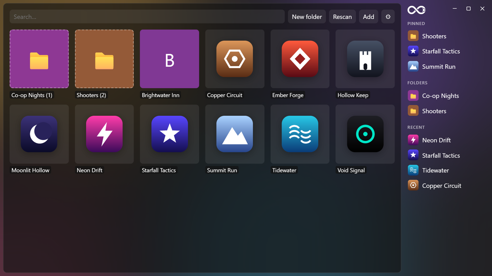

<p align="center">
  <picture>
    <source media="(prefers-color-scheme: dark)" srcset="docs/logo-dark.png">
    
  </picture>
</p>

<p align="center">One small, fast hub for every game and app on your PC, whatever store it came from.</p>

<p align="center"></p>

- **Every store in one grid:** finds your Steam, Epic and GOG games on its own; add anything else (an `.exe`, a shortcut, a `steam://` link) by dropping it on the window.
- **Light:** about 80 MB of RAM, a 3 MB program, no background services. It can close itself when you launch a game.
- **Yours to style:** frosted-glass window with Windows' own blur, adjustable opacity and frame, light/dark theme, image or GIF backgrounds, game icons pulled from each game's exe, custom covers.
- **Organised:** folders, a sidebar (left or right) with pinned games and recently played, type-to-search and full keyboard control.

## Download
Grab `LimitlessLauncher-1.0.0-setup.exe` from the [latest release](../../releases/latest) and run it. Windows 10/11 (64-bit). The app isn't code-signed yet, so Windows SmartScreen may warn you: choose **More info → Run anyway**.

## Build from source
Needs Rust, the Visual Studio C++ build tools and `cargo install tauri-cli --version "^2"`. Tauri v2 (Rust + WebView2), plain HTML/CSS/JS front end, no npm.
```
cd src-tauri
cargo tauri build          # installer in src-tauri/target/release/bundle/nsis/
cargo build --release      # or just the exe: src-tauri/target/release/launcher.exe
```
`cargo test` runs the Steam/Epic/GOG parser and exe-picking tests.

Data lives in `%APPDATA%\Launcher\` (`library.json`, `covers/`, `bg/`). A corrupt `library.json` is moved to `library.json.bad`, never overwritten.

## Using it
- **First run** scans Steam, Epic and GOG. **Rescan** adds new games and never touches your edits.
- **Add** (or drop an `.exe`/shortcut on the window) for anything else. A target can also be a URI such as `steam://…`.
- **Right-click** an item or folder for the menu: pin to sidebar, rename, set cover, move to folder, remove. Removing an imported game hides it; **⚙ → Restore hidden games** brings them back.
- **Drag** a tile onto a folder (in the grid or the sidebar, or onto **← Home** inside a folder) to move it.
- **Sidebar** (right or left, ⚙): pinned games/folders, all folders, last 8 launched. No title bar: drag the window by any empty space, double-click it to maximize.
- **Keyboard:** just type to search · ↑↓←→ move · Enter launches/opens · Esc clears search, then goes back.
- **⚙ Settings:** theme, background image/GIF, opacity (how see-through the window is), desktop blur (acrylic, mica or off: Windows' own, which has no strength setting; its legacy lighter blur draws black and flickers on Windows 11, so it isn't offered; skipped when opaque or when a background image covers the desktop), background blur, frosted edge (width of the glass frame around the content), close-after-launch.
- **Icons** are pulled automatically from each game's exe (Steam: the biggest exe in its install folder that isn't a crash reporter/installer/redist; Epic: its manifest's exe). A cover you set wins over the icon. Editing an item's target fetches its icon again.
- If a launch fails because the file is gone, the edit dialog opens so you can fix the path or remove it.

## RAM log
Sum of private working set (Task Manager's "Memory" column) over `launcher.exe` + its `msedgewebview2.exe` children, 8–10 s after start, release build.

| Milestone | State | Private WS | Procs | exe size |
|---|---|---|---|---|
| M1 | empty page | 75.7 MB | 7 | 3.0 MB |
| M2 | 200 items, no background | 81.8 MB | 7 | 3.2 MB |
| M3 | 200 items, no background | 82.6 MB | 7 | 3.2 MB |
| M4 | 200 items, no folders/covers | 81.1 MB | 7 | 3.3 MB |
| M4 | 200 items + 4 folders, 1 cover | 89 MB | 7 | 3.3 MB |
| M4 | 200 items + 25 folders, 25 covers on screen | 96.6 MB | 7 | 3.3 MB |
| M5 | 200 items, no background | 81–84 MB | 7 | 3.3 MB |
| M5 | 200 items + 1080p 24-frame GIF, visible | 85 MB | 7 | 3.3 MB |
| M5 | same, window minimized (background detached) | 112 MB | 7 | 3.3 MB |
| polish | 200 items, no background | 82.1 / 82.2 MB | 7 | 3.3 MB |
| glass | 23 items: clear glass / acrylic / opaque | 79.6 / 79.8 / 81.1 MB | 7 | 3.3 MB |
| icons | 23 items, ~20 icons on screen (same cost as covers, see below) | 95.5 MB | 7 | 3.3 MB |

**GIF cost:** visible, a 1080p GIF costs only ~4 MB (frames are decoded lazily). Minimizing *raises* RAM by ~15–25 MB when a GIF is set (also seen with the background left attached; not seen without a GIF) — cause not found. Detaching on minimize still pays off in CPU: 0.00 s vs 0.36 s per 10 s while minimized. A window merely *covered* by a game isn't detected (WebView2 reports no visibility change); **close-after-launch** is the real fix.

**Cover cost:** the first image costs ~8 MB (WebView2's image pipeline spins up), then ~0.3–0.5 MB per cover that is on screen (300×450 decoded). Off-screen covers are lazy-loaded and aren't decoded. If this matters, shrink the `300 / 450` limit in `setCover` (`ui/app.js`) — ~220×330 is still sharp at 150% scale.

## Known gaps / notes
- Not verified: picking a file in the native dialogs (they open and cancel fine), GOG on real data (none installed; tested against a fake registry entry), dropping a file onto the window.
- `window.confirm` is replaced by the dialog plugin with an async function, and its native `ask()` never showed a window here, so confirmations use an in-page `<dialog>`.
- Importers only look at installed games; uninstalled ones stay in the library until you remove them.

## License
[MIT](LICENSE)
